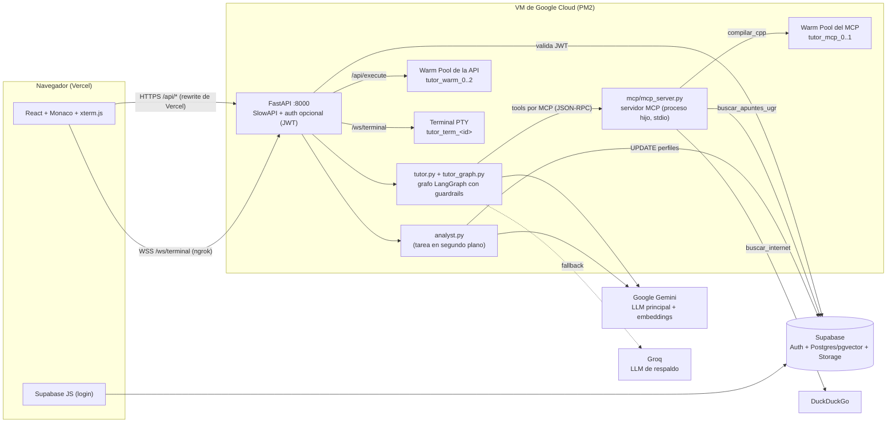
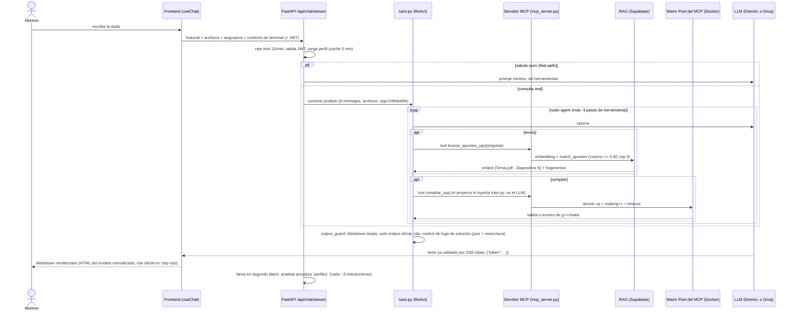
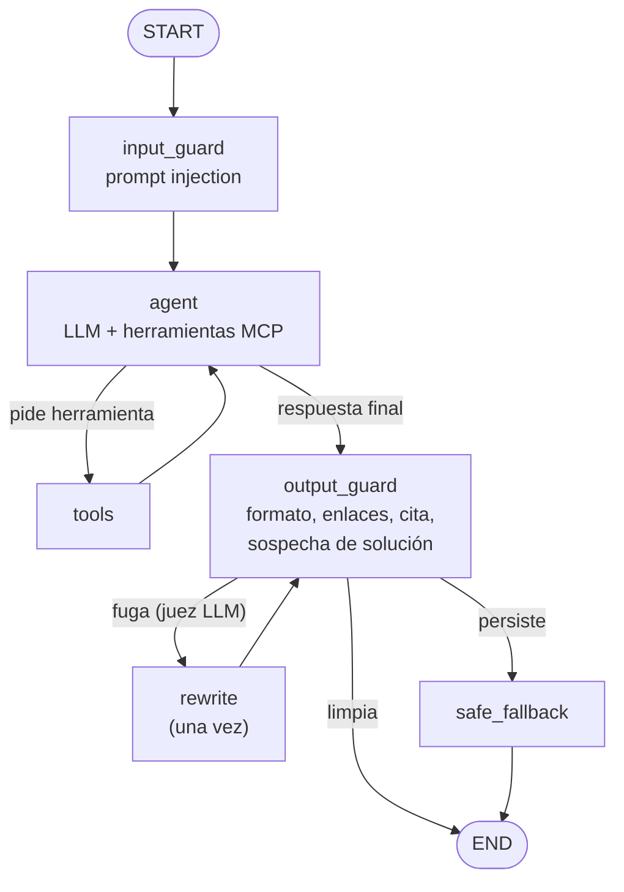

# Tutor IA Socrático (TutorIA) - TFG

IDE web asistido por un tutor de IA socrático para alumnos de la Universidad de Granada (UGR): **Fundamentos de Programación (FP)**, **Metodología de la Programación (MP, C/C++)** y **Fundamentos del Software (FS, Unix/Linux)**.

El tutor no da la solución: guía con pistas y preguntas, fundamenta la teoría en los apuntes oficiales (RAG con citas a la diapositiva exacta) y perfila en segundo plano las fortalezas y carencias del alumno. El código se compila y ejecuta en contenedores Docker aislados.

La referencia técnica completa (flujos, constantes, deuda técnica, resumen de la memoria) está en [`docs/EXPLICACION.md`](docs/EXPLICACION.md).

---

## Arquitectura



### Flujo de un mensaje del chat



### Flujo de compilación y ejecución

`POST /api/execute` y la tool `compilar_cpp` del tutor ejecutan el mismo código (`services/compiler.py`), cada una sobre su propio Warm Pool (el del proceso de la API y el del proceso MCP).

```mermaid
sequenceDiagram
    participant F as Frontend (Ejecutar)
    participant E as POST /api/execute (30/min)
    participant C as compiler.py (asyncio, no bloquea)
    participant P as Warm Pool
    participant K as Contenedor tutor_warm_N

    F->>E: {archivos}
    E->>C: compile_and_run_project
    C->>P: get_container() (máx. 30 s; si no hay, "servidor ocupado")
    P-->>C: contenedor sano (comprobado con docker inspect)
    C->>K: docker cp del proyecto + make o g++ ; timeout 30 ./programa
    K-->>C: stdout, o log de compilación si falla (124 = tiempo, 137 = memoria)
    C->>P: release(): el contenedor se destruye y se recrea en segundo plano
    C-->>F: {output, isError}
```

---

### Grafo del tutor y guardrails



El detalle de cada nodo está en la sección 6.4.9 de [`docs/EXPLICACION.md`](docs/EXPLICACION.md). Con `TUTOR_GRAPH=0` se vuelve al agente ReAct prefabricado, útil para comparar con y sin guardrails.

---

## Seguridad y robustez

| Capa | Medida | Dónde |
| :--- | :--- | :--- |
| Sandbox de compilación | `--network none`, `--memory 256m` (sin swap), `--cpus 0.5`, `--pids-limit 64`, `--cap-drop ALL`, usuario `alumno` sin privilegios, `timeout 30` dentro y 60 s de tope en el host | `services/warm_pool.py`, `services/compiler.py` |
| Estado limpio entre alumnos | Tras cada uso el contenedor se destruye y se recrea; si uno cae se detecta y se recrea; si no hay ninguno libre en 30 s se avisa al alumno | `services/warm_pool.py` |
| Terminal Linux | Un contenedor nuevo por conexión: `--network none`, `--cap-drop ALL`, `--cpus 1`, `--memory 512m`, `--pids-limit 100`, `--user 1000:1000`; máximo 10 terminales a la vez (`MAX_TERMINALS`); limpieza sin procesos zombi (`SIGTERM`, `SIGKILL`, `waitpid`, `docker rm -f`) | `routers/terminal.py` |
| Anti-abuso | SlowAPI por alumno (token JWT, si no IP real): chat **15/min**, ejecución **30/min**. La terminal no se limita a propósito para que los alumnos puedan probar | `services/rate_limit.py` |
| No bloquear el servidor | La compilación usa `asyncio.create_subprocess_exec`; la API sigue respondiendo mientras un alumno ejecuta código | `services/compiler.py` |
| Entrada validada | Rutas de archivo relativas y sin `..`, tamaño del proyecto acotado, nombres escapados en el script, salida de un programa limitada a 64 KB | `schemas/payload.py`, `services/compiler.py` |
| Memoria RAM | `/upload-pdf` rechaza archivos de más de 10 MB con 413 y limita las sesiones en memoria | `routers/uploadPDF.py` |
| Datos | JWT de Supabase opcional (modo anónimo sin perfil); RLS en `perfiles`; el backend usa la clave `service_role` y solo toca `perfiles` filtrando por el usuario del token | `auth/verify.py`, `supabase_setup.sql` |
| Guardrails del tutor | Detección de prompt injection, HTML a Markdown, solo el enlace oficial a los apuntes, cita obligatoria si se consultaron los apuntes, y control de fuga de solución (heurística, juez LLM, una reescritura socrática y mensaje seguro de último recurso) | `guardrails.py`, `tutor_graph.py` |
| Enlaces en el frontend | El frontend convierte `<a href>` en Markdown, pinta como cita oficial solo los enlaces al bucket de apuntes y marca cualquier otro como externo | `frontend/src/lib/tutorLinks.ts`, `ChatMessage.tsx` |
| Resiliencia de LLM | Gemini primario, Groq de respaldo y modelo rápido como último recurso; si el servidor MCP no arranca el tutor responde sin herramientas; streaming por SSE con respaldo a `/api/chat` | `tutor.py`, `frontend/src/services/api.ts` |

Limitaciones conocidas y tareas pendientes: sección 8 de [`docs/EXPLICACION.md`](docs/EXPLICACION.md).

---

## Stack

**Frontend:** React 19, TypeScript, Vite 7, Tailwind 4, Monaco Editor, xterm.js, react-markdown, JSZip, Supabase JS.

**Backend:** FastAPI + uvicorn, LangChain y LangGraph (`StateGraph` propio con guardrails), MCP (FastMCP + `langchain-mcp-adapters`), Gemini y Groq, Supabase (Postgres + pgvector con índice HNSW, Auth, Storage), `pypdf`, DuckDuckGo Search, SlowAPI, Docker.

**Despliegue:** Vercel (frontend), VM de Google Cloud con PM2 y ngrok (backend y WSS). GitHub Actions ejecuta tests, lint y build antes de desplegar por SSH.

---

## Puesta en marcha

Guía completa con cuentas gratuitas: [`docs/GUIA_TRASPASO_NUEVO_ALUMNO.md`](docs/GUIA_TRASPASO_NUEVO_ALUMNO.md). Despliegue en servidor: [`docs/DESPLIEGUE.md`](docs/DESPLIEGUE.md).

Prerrequisitos: Node 18+, Python 3.11+, Docker en ejecución y claves de Supabase, Gemini y Groq.

```bash
# 1. Base de datos: pegar backend/supabase_setup.sql en el SQL Editor de Supabase
#    y crear el bucket PÚBLICO "apuntes" en Storage.

# 2. Backend
cd backend
cp .env.example .env            # rellenar claves (SUPABASE_KEY debe ser la service_role)
python3 -m venv venv && source venv/bin/activate
pip install -r requirements.txt
(cd docker && docker build -t tutor-ugr-image:latest .)   # imagen del sandbox, obligatoria
python setup_rag.py             # sube los PDFs y vectoriza los apuntes (opción 1)
uvicorn main:app --reload --port 8000                     # Swagger en /docs

# 3. Frontend (otra terminal)
cd frontend
cp .env.example .env
npm install
npm run dev                     # http://localhost:5173
```

El backend no arranca si Docker no está disponible o falta la imagen `tutor-ugr-image`, porque el Warm Pool se crea al iniciar. Al arrancar, la API lanza también el servidor MCP (`backend/mcp/mcp_server.py`) como proceso hijo; no hay que arrancarlo a mano. Tarda unos segundos porque crea su propio pool de 2 contenedores (`MCP_POOL_SIZE`).

---

## Tests

```bash
cd backend && source venv/bin/activate
pytest tests/ -m "not llm" -v     # todo salvo lo que usa claves reales de LLM
pytest tests/ -m llm -v           # chat real con Gemini/Groq (consume cuota)
```

| Archivo | Qué cubre | Necesita |
| :--- | :--- | :--- |
| `test_compile.py` | Compilación válida, error de sintaxis, Makefile, bucle infinito, aislamiento de red | Docker + imagen |
| `test_warm_pool.py` | Contenedor reciclado sin restos del alumno anterior, `PoolBusyError`, contenedor caído recreado | Docker + imagen |
| `test_mcp.py` | El servidor MCP expone las 3 tools, `compilar_cpp` usa el proyecto del contexto, no hay ruido en stdout | Docker + imagen |
| `test_compiler_robustez.py` | Error de ejecución y de compilación, salida infinita cortada, rutas peligrosas, nombres con metacaracteres | Docker + imagen |
| `test_rate_limit_execute.py` | 429 en `/api/execute` al superar el límite (compilador simulado) | Docker + imagen |
| `test_tutor_helpers.py` | Detección de saludos (fast-path) sin falsos positivos | Nada |
| `test_guardrails.py`, `test_tutor_graph.py` | Guardrails y grafo completo con modelos falsos (injection, juez, reescritura, fallback, cita) | Nada |
| `test_archivos.py` | `/upload-pdf`: cabecera obligatoria, PDF vacío, límite de 10 MB | Docker + imagen |
| `test_terminal.py` | El WebSocket de la terminal abre y cierra | Docker + imagen |
| `test_ia.py`, `test_api.py` | Chat, streaming, rate limit del chat y detección de un error lógico (marcados `llm`) | Claves reales de Gemini/Groq |

`pytest tests/ -m "not llm"` es lo que ejecuta la integración continua.

---

## Estructura

```
backend/   main.py, tutor.py, tutor_graph.py, guardrails.py, routers/, services/ (warm_pool, compiler, search, analyst, rate_limit), auth/, schemas/, docker/, ingest*.py, setup_rag.py, supabase_setup.sql, tests/
frontend/  src/{App.tsx, hooks/, services/api.ts, components/{auth,chat,editor,layout}}, vercel.json
docs/      EXPLICACION.md, GUIA_TRASPASO_NUEVO_ALUMNO.md, DESPLIEGUE.md, memoria del TFG (PDF)
```

Las tres herramientas del tutor (`buscar_apuntes_ugr`, `compilar_cpp`, `buscar_internet`) se sirven desde `backend/mcp/mcp_server.py`. `tutor.py` solo se conecta como cliente MCP y monta el grafo de `tutor_graph.py`: la tool `compilar_cpp` se le ofrece al LLM sin parámetros y `tutor.py` inyecta el proyecto del alumno al llamar a la tool, de modo que el modelo no puede inventar el código.
